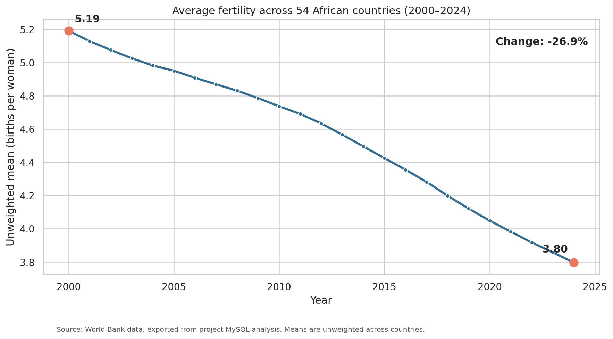
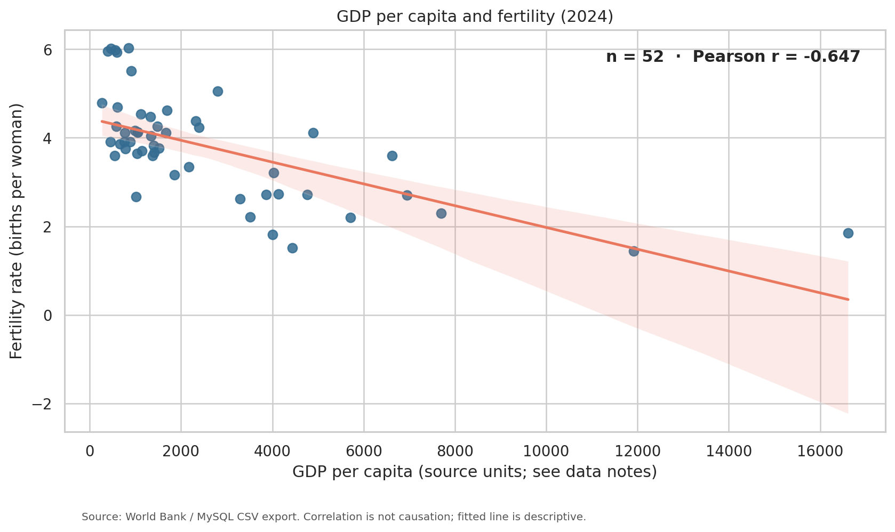
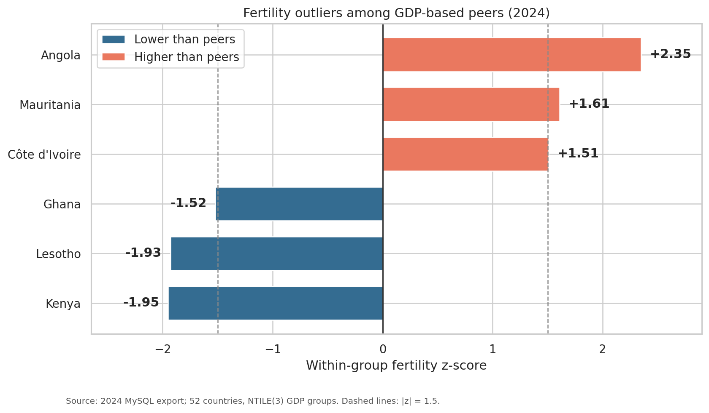

# Africa’s Fertility Paradox

**Fertility trends, socioeconomic associations, and demographic outliers (2000–2024)**  
Tools: **MySQL** for data preparation and outlier detection; **Python (pandas, Seaborn/Matplotlib)** for correlations and visualization.

> **Reproduction status:** All **seven included CSV-to-Python analyses** have been rerun and checked against the recorded findings. The six SQL scripts retain the original stepwise workflow, but **full reconstruction from raw World Bank downloads is not yet established** because the original raw imports and exact source metadata are unavailable. See [validation details](docs/validation_record.md).

## Research questions

1. How did fertility change across 54 African countries during 2000–2024?
2. How was fertility associated with GDP per capita, urbanization, and female secondary gross enrollment?
3. Which countries had unusually high or low fertility relative to their **GDP-based peers in 2024**?

## Data and methods

The existing MySQL view `africa_fertility_panel` has **1,350 country-year observations** (54 countries × 25 years) with complete fertility coverage. GDP, urbanization, and education indicators have different coverage. The World Bank exports were joined in MySQL; selected result sets were exported as seven CSVs. **Pearson correlations are calculated in Python**, not in the socioeconomic SQL script.

For outliers, MySQL ranked the **52 countries** with 2024 GDP and fertility observations using `NTILE(3)` (**18, 17, and 17 countries**). A within-peer-group fertility z-score used `STDDEV_POP`; the project flagged countries with **|z| ≥ 1.5**, using z-scores rounded to two decimals. A sensitivity check repeated the method with `NTILE(4)`.

## Key findings

| Analysis | Result |
| --- | --- |
| Unweighted country mean fertility, 2000 → 2024 | **5.191 → 3.795 births per woman (−26.9%)** |
| GDP per capita vs fertility, **2024** | Pearson **r = −0.647** (n=52) |
| Urban population share vs fertility, **2024** | Pearson **r = −0.345** (n=54) |
| Female secondary gross enrollment vs fertility, **2011** | Pearson **r = −0.903** (n=37) |

The 2011 education year was selected for better country coverage than 2024. Correlations are **associations, not causal effects**.

### Fertility trends



### Fertility and socioeconomic indicators



The notebook also creates the **GDP 2000 vs 2024**, **education 2011**, **urbanization 2024**, and **urbanization 2000 vs 2024** charts. All seven image files are saved in [`visualizations/`](visualizations/).

### Countries unusual relative to GDP peers (2024)



| Higher than peers | z-score | Lower than peers | z-score |
| --- | ---: | --- | ---: |
| Angola | +2.35 | Kenya | −1.95 |
| Mauritania | +1.61 | Lesotho | −1.93 |
| Côte d'Ivoire | +1.51 | Ghana | −1.52 |

Four GDP peer groups flagged **seven** outliers: Chad, Equatorial Guinea, Morocco, Lesotho, Angola, Mali, and Djibouti. **Only Angola and Lesotho** appear in both lists, so outlier designations are **sensitive to the grouping choice**. These results do not establish persistent outlier status.

## Repository structure

```text
africas-fertility-paradox/
├── README.md
├── requirements.txt
├── sql/                         # Six small, stepwise MySQL scripts
├── python/
│   └── fertility_visuals.ipynb # Pearson correlations + seven visualizations
├── data/
│   ├── README.md
│   └── analysis_outputs/       # Seven supplied MySQL-exported CSVs
├── visualizations/              # Seven notebook-generated charts + original outlier chart
└── docs/                        # Validation and SQL review notes
```

## Reproducing the Python results

From the **repository root**:

```bash
python -m pip install -r requirements.txt
jupyter notebook python/fertility_visuals.ipynb
```

In the notebook, select **Run All**. It reads the seven included CSVs and regenerates the plots in `visualizations/`. The notebook can also be launched from the `python/` folder. Results were tested using the included exports; running the original SQL pipeline from raw inputs requires recovering the missing import details.

## SQL workflow and limitations

The six scripts in [`sql/`](sql/) preserve **multiple task-focused queries per file**, including source audits, exploratory analyses, year-specific extracts, and GDP peer outlier calculations. Read [`sql/README.md`](sql/README.md) **before executing any setup statements**: `01_database_setup.sql` includes **one-time `ALTER TABLE ... RENAME COLUMN` operations**, and missing original import scripts prevent a verified fresh-database run.

Other caveats: missingness changes sample sizes; the GDP source price/currency basis needs metadata confirmation; the original GDP CSVs contain one name-encoding artifact; z-score cutoff and group count are analyst choices; and cross-sectional relationships do not demonstrate causation.

For the precise checks, see [`docs/validation_record.md`](docs/validation_record.md). For source-file provenance, see [`data/README.md`](data/README.md).
